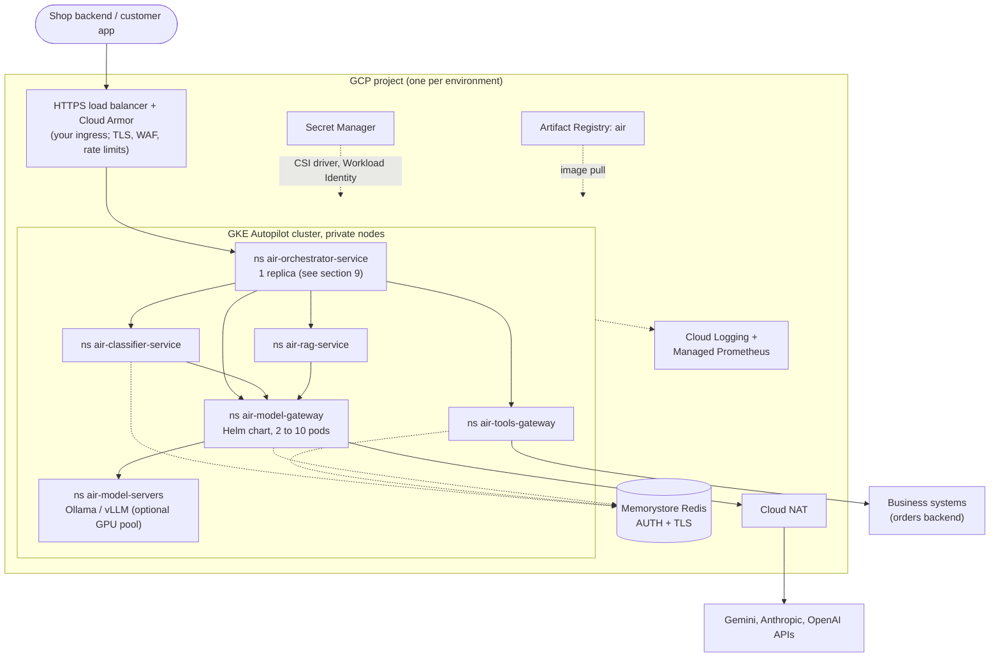

# GCP deployment guide

For **DevOps engineers** taking the AIR platform to Google Cloud. It answers three
questions:

1. What does each thing in this repository's local stack become in GCP?
2. What does each AIR service need to run there?
3. How do you build, push and deploy each service's Docker image?

It also says plainly what does not exist yet, so nothing here is mistaken for a
tested production setup.

> **Status of this guide (2026-11-17).** The deployment code for all five services
> is in this repository, under [`gke/`](../gke/README.md): two Helm charts, values
> per service for UAT and production, Terraform and scripts. All five were deployed
> with it to a local `kind` cluster and passed their smoke tests. **None of it has
> been applied to a real GCP project yet.** This page explains what each service
> needs and why; [03-gke-runbook.md](03-gke-runbook.md) is the procedure.

New to the platform? Read the
[platform overview](../../air-web-console/docs/platform/01-overview.md) first. Unknown
AI terms are explained in
[concepts](../../air-web-console/docs/platform/02-concepts.md).

- [1. This repository is not deployed](#1-this-repository-is-not-deployed)
- [2. Local stack to GCP: what replaces what](#2-local-stack-to-gcp-what-replaces-what)
- [3. Target shape](#3-target-shape)
- [4. What each service needs](#4-what-each-service-needs)
- [5. Building and pushing images](#5-building-and-pushing-images)
- [6. How each service is deployed](#6-how-each-service-is-deployed)
- [7. Secrets](#7-secrets)
- [8. Deployment order and smoke tests](#8-deployment-order-and-smoke-tests)
- [9. Constraints you must design around](#9-constraints-you-must-design-around)
- [10. Checklist before the first environment](#10-checklist-before-the-first-environment)

## 1. This repository is not deployed

air-infrastructure-service exists so that every developer's laptop has the same Redis,
Postgres and MongoDB, on one Docker network, with one command. Its Go service (the
credential broker on `:8080`) and its `docker-compose.yml` **never run in GCP**. In a
deployed environment, managed services take their place and each AIR service is given
its connection settings directly, as environment variables or mounted secrets.

What you take from this repository is the **inventory**: the list of things the
platform expects to exist. The rest of this guide is that inventory, mapped to GCP.

## 2. Local stack to GCP: what replaces what

| Local (this repository) | Used by | In GCP | Notes |
| --- | --- | --- | --- |
| Redis 7 (`redis:6379`, password) | air-classifier-service (cache, idempotency), air-tools-gateway (proposals, idempotency, locks), air-model-gateway (cache, rate limits, quotas, spend) | **Memorystore for Redis**, AUTH and in-transit TLS, private IP | The gateway's Terraform creates its own instance. Decide whether the classifier and tools gateway share it (separate key prefixes: `air:clf:`, `airtg:`) or get their own. See the TLS note in section 9 |
| Postgres 16 + pgbouncer | **Nothing yet** | Do not provision | Reserved for later phases. No service opens a Postgres connection today |
| MongoDB 7 | air-classifier-service, optional audit log only (`AUDIT__BACKEND=mongo`, off by default) | Skip, or MongoDB Atlas if the audit log is wanted | Records expire by TTL (30 days by default) |
| Credential broker (`:8080`) | Developer convenience | **Secret Manager** + **Workload Identity** | Each service reads its own secrets. No broker in between |
| Docker network `air-net` | Service-to-service DNS | One **GKE** cluster, one namespace per service, `NetworkPolicy` between them | Services call each other by cluster DNS name |
| Prometheus + Grafana (`--profile observability`) | Metrics | **Google Cloud Managed Service for Prometheus** and Cloud Monitoring | Every service exposes `GET /metrics`. The gateway's chart ships a `PodMonitoring` resource to copy |
| Container logs | Logs | **Cloud Logging** | Every service writes structured JSON to stdout when its log format is `json` |
| Ollama on the developer's machine | air-model-gateway's `local` class and the `local-768-v1` embedding model | A model server in the cluster (Ollama, vLLM or llama.cpp, usually on a GPU node pool), or none | **air-rag-service cannot work without an embedding model server.** See section 9 |
| `.env` files | Configuration | ConfigMaps for settings, Secret Manager for secrets | `.env.example` in each repository lists every variable and marks the secrets |
| `docker compose build` | Images | **Artifact Registry**, one repository | Section 5 |
| Cloud provider APIs reached from the laptop | air-model-gateway only | **Cloud NAT** egress to the Gemini, Anthropic and OpenAI APIs | Only the gateway needs internet egress |

## 3. Target shape

One GKE Autopilot cluster per environment (UAT, production), one namespace per
service, nothing exposed except the orchestrator.



- **Only air-orchestrator-service is reachable from outside the cluster**, and only
  through your ingress. Every other service is `ClusterIP` only.
- **Only air-model-gateway needs internet egress.** The rest talk to in-cluster
  services and Memorystore.
- **air-web-console is not deployed.** It is a local test tool. To test a deployed
  environment, an engineer runs the console on their own machine and adds the
  environment as a target in `.env.local` (base URLs and keys), reaching the services
  over VPN or `kubectl port-forward`.

## 4. What each service needs

Container ports are the ports **inside** the image. The 808x numbers in the local port
map are host-side conventions for running everything on one laptop.

| | air-orchestrator-service | air-classifier-service | air-model-gateway | air-rag-service | air-tools-gateway |
| --- | --- | --- | --- | --- | --- |
| **Runtime** | Python 3.12 | Python 3.12 | Python 3.12 | Python 3.12 | Node.js 22 |
| **Container port** | 8081 | 8080 | 8080 | 8080 | 8080 |
| **Runs as** | uid 10001 | uid 1001 | uid 10001 | uid 10001 | uid 10001 |
| **Image size (local build)** | 297 MB | 556 MB | 370 MB | 241 MB | 358 MB |
| **Liveness probe** | `GET /v1/health` | `GET /v1/health` | `GET /v1/health` | `GET /v1/health` | `GET /v1/health` |
| **Readiness probe** | `GET /v1/ready` | `GET /v1/ready` | `GET /v1/ready` | `GET /v1/ready` | `GET /v1/ready` |
| **Metrics** | `GET /metrics` | `GET /metrics` | `GET /metrics` | `GET /metrics` | `GET /metrics` |
| **Settings prefix** | `AIR_ORCHESTRATOR_SERVICE__` | `AIR_CLASSIFIER__` | `AIR_MODEL_GATEWAY_` | `AIR_RAG_SERVICE__` | `AIR_TOOLS_GATEWAY__` |
| **Calls** | gateway (required); classifier, RAG, tools gateway (optional) | gateway (optional) | model servers, cloud APIs | gateway (required) | business systems |
| **Redis** | No (see section 9) | Optional: required for more than one replica | Optional: required for more than one replica | No | Optional: required for more than one replica |
| **State held in memory** | Sessions, proposals | Cache when Redis is off | Cache, limits when Redis is off | **The whole search index** | Fixture order data; proposals when Redis is off |
| **Replicas today** | **Exactly 1** | 1 or more with Redis | 2 or more with Redis | 1 or more, each builds its own index at start | 1 or more with Redis |
| **Internet egress** | No | No | Yes | No | To the business backend |
| **Chart** (in `gke/helm/`) | `air-service` | `air-service` | `air-model-gateway` | `air-service` | `air-service` |
| **Deploy pipeline** | None yet | None yet | `deploy.yml` in its repository | None yet | None yet |

Probe rules that apply to every service:

- **Liveness must be `/v1/health` only.** It never touches a dependency. Do not point
  liveness at `/v1/ready`: a dependency outage would restart healthy pods.
- **Readiness is `/v1/ready`,** but read each service's meaning of it first.
  The classifier answers 200 with `"status":"degraded"` when the gateway is down and
  it can still answer on its cheap tiers: that is still ready. The orchestrator and
  the RAG service are unready without the gateway. The tools gateway turns unready on
  `SIGTERM` while it drains.
- **Give the tools gateway a termination grace period of at least 30 seconds.** It
  finishes running executes before it exits (`SHUTDOWN__DRAIN_TIMEOUT_MS`, 20 s).

## 5. Building and pushing images

Each service's repository owns its `Dockerfile` and builds its own image. Every one
has the same two targets: `make image` (a local build) and `make image-push` (built
for `linux/amd64`, tagged with the commit, pushed to `IMAGE_REPOSITORY`).

One-time setup:

```bash
export PROJECT=<gcp-project> REGION=<region>            # e.g. us-central1
gcloud artifacts repositories create air --repository-format=docker \
  --location=$REGION --project=$PROJECT                 # skip if the gateway's Terraform created it
gcloud auth configure-docker $REGION-docker.pkg.dev
export REGISTRY=$REGION-docker.pkg.dev/$PROJECT/air
```

Build and push one service (the same two lines for any of them):

```bash
cd ../air-rag-service
make image-push IMAGE_REPOSITORY=$REGISTRY/air-rag-service      # tag: this commit
```

`make image-push` builds with `--platform linux/amd64`. That matters on Apple Silicon
laptops: without it the image is `arm64` and won't start on standard GKE nodes.

Per-service build notes:

| Repository | Build notes |
| --- | --- |
| air-model-gateway | The Makefile passes the commit as the `REVISION` build argument, so `/v1/health` reports it. Its pipeline (`.github/workflows/deploy.yml`) builds once and promotes the same digest from UAT to production: prefer that to a manual push |
| air-classifier-service | By default the Tier 1 model is **not** in the image, and Tier 1 runs on a weaker fallback, which sends far more traffic to paid tiers. Either bake it in (`make image-push MODEL_URL=… MODEL_SHA256=… TOKENIZER_URL=… TOKENIZER_SHA256=…`), or mount `model.onnx` and `tokenizer.json` at `/opt/models`. `scripts/export_zeroshot_model.py` produces the files |
| air-orchestrator-service | No arguments. The image has no `HEALTHCHECK` on purpose: declare probes in the manifest |
| air-rag-service | No arguments. The development corpus (`sit/corpus`) is **not** in the image. See section 9 |
| air-tools-gateway | No arguments. The image contains the fixture order data (`/app/fixtures`), which is the only backend that exists in v1 |
| air-web-console | Not deployed. If you do build it, `NEXT_PUBLIC_AIR_WEB_GATEWAY_TOKEN` must be a **build** argument |
| air-infrastructure-service | Not deployed |

Tags in Artifact Registry should be immutable (the gateway's Terraform module sets
this). Deploy by digest or by commit tag, never by `latest`.

## 6. How each service is deployed

The procedure is [03-gke-runbook.md](03-gke-runbook.md). This section explains the
pieces.

**Two charts.** air-model-gateway has its own (`gke/helm/air-model-gateway`), because
it mounts three configuration files and reads its secrets as files. The other four
share one (`gke/helm/air-service`): everything that differs between them is a value.
Both encode the same platform decisions: non-root, read-only root filesystem, probes
on `/v1/health` and `/v1/ready`, secrets through the Secret Manager CSI driver,
`PodMonitoring`, and a `NetworkPolicy` that admits named namespaces only.

**One values file per service per environment**, in `gke/values/uat/` and
`gke/values/prod/`. Each holds the image, the start command, the settings that differ
from the service's defaults, the list of its secrets, its replica policy and its
allowed callers. The settings tables below are what those files contain, with the
reasons.

**Who deploys.** A service's team, from its own repository: `make image-push`, then
`make deploy DEPLOY_ENV=uat …`, which calls this repository's `make gke-deploy`. Or
DevOps, from here, for an image that already exists. Either way the Helm arguments
come from one script, `gke/scripts/release.sh`.

**How the four services get their secrets.** They read environment variables, not
files. The shared chart mounts each secret as a file named like the variable, and
starts the container through a small shell wrapper that exports every file and then
`exec`s the service's own start command. Nothing secret appears in a manifest. This
needs no change in any service; the cleaner long-term form is for each service to
read a secrets directory itself, as the gateway does.

In-cluster addresses (each Service listens on port 80 and forwards to the container
port):

| Service | Address for its callers |
| --- | --- |
| air-model-gateway | `http://air-model-gateway.air-model-gateway.svc.cluster.local` |
| air-classifier-service | `http://air-classifier-service.air-classifier-service.svc.cluster.local` |
| air-rag-service | `http://air-rag-service.air-rag-service.svc.cluster.local` |
| air-tools-gateway | `http://air-tools-gateway.air-tools-gateway.svc.cluster.local` |
| air-orchestrator-service | `http://air-orchestrator-service.air-orchestrator-service.svc.cluster.local` |

### Settings that differ from the development defaults

These are already set in the values files; the tables explain them. Each repository's
`.env.example` documents every variable. **S** marks a secret: its value lives in
Secret Manager, and the values file lists only its name.

**air-orchestrator-service** (prefix `AIR_ORCHESTRATOR_SERVICE__`)

| Setting | Value in GCP |
| --- | --- |
| `APP__ENV` | `staging` in UAT, `production` in prod |
| `APP__WORKERS` | `1` (more is ignored while sessions are in memory) |
| `OBS__LOG_FORMAT` | `json` |
| `MODEL_GATEWAY__BASE_URL` | The gateway's in-cluster address |
| `MODEL_GATEWAY__API_KEY` **S** | This service's gateway token |
| `MODEL_GATEWAY__MODEL_CLASS`, `PLANNER__MODEL_CLASS` | `cloud` (the configuration the integrated tests ran with) |
| `PLANNER__ENABLED` | `true` to allow order lookups and changes |
| `DOWNSTREAM__CLASSIFIER__ENABLED`, `…__BASE_URL`, `…__API_KEY` **S** | `true`, the classifier's address, a classifier API key |
| `DOWNSTREAM__RAG__ENABLED`, `…__BASE_URL`, `…__API_KEY` **S** (or `…__TENANT_KEYS` **S**) | `true`, the RAG service's address, one RAG key per tenant |
| `DOWNSTREAM__TOOLS_GATEWAY__ENABLED`, `…__BASE_URL`, `…__TENANT_KEYS` **S**, `…__ALLOW__CUSTOMER` | `true`, the tools gateway's address, a read key and an execute key per tenant, the allowed capability patterns |
| `SECURITY__HASH_SALT` **S** | A new random value |
| `SECURITY__API_KEYS_FILE` (or `…_INLINE`) **S** | Key records hashed with that salt. Set `allow_actions` per key deliberately |
| `SECURITY__CUSTOMER_TOKENS` | The **public** keys of whoever signs customer tokens in that environment (the shop's backend) |
| `PROMPTS__PERSONA__BRAND_NAME` | The shop's name |
| `INFRA__*` | Leave unset: there is no broker in GCP. `/v1/ready` will list `air-infra` as unreachable; it doesn't affect readiness (see section 9) |

**air-classifier-service** (prefix `AIR_CLASSIFIER__`; the prefix has no `_SERVICE` on purpose)

| Setting | Value in GCP |
| --- | --- |
| `APP__ENV` | `staging` in UAT, `production` in prod |
| `APP__DOCS_ENABLED` | `false` in prod |
| `MODEL_GATEWAY__BASE_URL`, `MODEL_GATEWAY__TOKEN` **S** | The gateway's address and this service's token |
| `CACHE__BACKEND`, `CACHE__REDIS_URL` **S** | `redis` and the Memorystore URL, for more than one replica |
| `SECURITY__HASH_SALT` **S**, `SECURITY__API_KEYS_FILE` **S** | New salt; key records hashed with it. **The development salt is not rejected in production**: check it by hand |
| `AUDIT__BACKEND`, `AUDIT__MONGO_URL` **S** | Leave `none` unless the audit log is wanted |

The repository's README has a fuller production checklist ("Deployment and operations").

**air-rag-service** (prefix `AIR_RAG_SERVICE__`)

| Setting | Value in GCP |
| --- | --- |
| `APP__ENV` | `staging` in UAT, `production` in prod (which refuses unauthenticated mode) |
| `MODEL_GATEWAY__BASE_URL`, `MODEL_GATEWAY__API_KEY` **S** | The gateway's address and this service's token |
| `SECURITY__HASH_SALT` **S**, `SECURITY__API_KEYS_FILE` **S** | New salt; one key record per tenant, each with a `tenant` |
| `INGESTION__SEED_DIR` | A directory of documents mounted into the pod. Without it the index is empty and every search returns no sources |
| `RETRIEVAL__MIN_SCORE` | `0.5` was tuned on the development corpus. Re-check on real documents |

**air-tools-gateway** (prefix `AIR_TOOLS_GATEWAY__`)

| Setting | Value in GCP |
| --- | --- |
| `APP__ENV` | `production` in both (it has no `staging`); refuses to start on the development salt |
| `HTTP__PORT` | `8080` |
| `SECURITY__HASH_SALT` **S**, `SECURITY__API_KEYS` **S** | New salt; a `read` and an `execute` key record per tenant |
| `STORE__BACKEND`, `STORE__REDIS_URL` **S**, `STORE__KEY_PREFIX` | `redis`, the Memorystore URL, `airtg` |
| `BACKEND__MODE` | `fixture` is the only value that exists. See section 9 |

## 7. Secrets

Never put a secret in an image, a ConfigMap or a values file. Terraform creates an
empty Secret Manager secret for each one and grants read access to exactly the
service account that needs it; you add the values
([runbook §5.2 and §5.3](03-gke-runbook.md#52-the-gateways-secrets)). The charts mount
them into the pods.

The secrets the platform needs, per environment:

| Secret | Held by | Consumed by | Created by |
| --- | --- | --- | --- |
| Cloud provider API keys (Gemini, Anthropic, OpenAI) | air-model-gateway | air-model-gateway only | You, through `deploy/gke/bootstrap-secrets.sh` |
| Gateway service tokens, one per calling service | air-model-gateway (the `token:service` map) | Each caller, as its own gateway token | `bootstrap-secrets.sh`, into `<service>-model-gateway-token` |
| Memorystore URL with AUTH string, and its CA | Terraform | air-model-gateway, air-classifier-service, air-tools-gateway | Terraform (it ends up in state: restrict the state bucket) |
| Each service's `HASH_SALT` | That service | That service | You. A random string per service per environment |
| API key records (digests) for each service | That service | That service | You: hash each raw key with the service's salt. The raw key goes to the caller |
| Raw API keys the orchestrator sends to the classifier, RAG service and tools gateway | air-orchestrator-service | air-orchestrator-service | The raw halves of the records above |
| Customer-token **public** keys | air-orchestrator-service | air-orchestrator-service | The shop's backend owns the private key. Not a secret, but environment-specific |

All four services store the same digest of an API key, `sha256(salt + raw key)` in
hex. One script produces it for any of them:

```bash
gke/scripts/hash-key.sh "<salt>" "<raw key>"
```

**Every key and salt in every `.env.example` is a published development value.** None
may be used in a deployed environment.

## 8. Deployment order and smoke tests

Deploy in dependency order, and check each service before the next:

| Order | Service | Smoke test (from inside the cluster, or through `kubectl port-forward`) |
| --- | --- | --- |
| 0 | Memorystore, Secret Manager, model servers | Terraform outputs; the model server answers |
| 1 | air-model-gateway | `make gke-smoke SERVICE=air-model-gateway …`. `/v1/ready` lists each provider as `true` or `false` |
| 2 | air-classifier-service | `/v1/ready` is `ok`. One `POST /v1/classify`; `decided_by` in the response shows which tier answered |
| 3 | air-rag-service | `/v1/ready` is `ready: true` with a non-zero `document_count` |
| 4 | air-tools-gateway | `/v1/ready` shows `orders_backend` and `store` both `ok`. `BASE_URL=… bash sit/smoke.sh` walks lookup, propose, execute and replay (it cancels a fixture order) |
| 5 | air-orchestrator-service | `/v1/ready` is `ready: true`, and lists each dependency as `configured: true`. One `POST /v1/chat` |

`make gke-smoke SERVICE=<service> …` runs these checks for you. `/v1/health` and
`/v1/ready` need no API key on any service. Everything else does.

To exercise a deployed environment thoroughly, add it as a target to air-web-console
(`AIR_WEB__TARGETS__<NAME>__…` in its `.env.local`) and run its contract suites
against it: `make gateway-check GATEWAY_TARGET=<name>`, `make rag-check RAG_TARGET=<name>`,
`make tools-check TOOLS_TARGET=<name>`. On a remote target the suites skip rows that
change data unless told otherwise.

## 9. Constraints you must design around

These are properties of the code as it stands. Each is recorded in the owning
repository; none is hidden.

| Constraint | Consequence for deployment | Where it is recorded |
| --- | --- | --- |
| **The orchestrator keeps sessions in process memory.** | Run **exactly one replica**, with one worker. Two replicas without session affinity fail about half of all follow-up messages with a 404. Every restart or deploy drops all conversations in progress. Use a `Recreate` strategy or accept the drop, and no HPA | Orchestrator spec 0015, spec 0002 (durable sessions, not built) |
| **The RAG service keeps its index in memory and builds it at start-up** from `INGESTION__SEED_DIR`, embedding every document through the gateway. | Start-up time grows with the corpus; each replica builds its own copy; the gateway's embedding model must be up before the pod starts or the index is empty. No route adds documents at run time | air-rag-service README, `docs/00-plan.md` |
| **The RAG index is tied to the embedding model `local-768-v1`,** which the gateway serves from a local model server (`nomic-embed-text` on Ollama). | The cluster needs a model server for embeddings even if all chat traffic uses cloud models. Changing the embedding model means re-indexing | Gateway `deploy/routing.yaml`; RAG `CLAUDE.md` |
| **The tools gateway has only a fixture backend.** `BACKEND__MODE` accepts `fixture` and nothing else. | A deployed tools gateway serves sample orders from the image, and a restart resets them. Connecting real order systems is application work (an `OrdersBackend` implementation), not configuration | air-tools-gateway `docs/enhancements.md` |
| **The orchestrator's rate limit is configured but not enforced.** | Put rate limiting at the ingress (Cloud Armor) until it is | air-web-console `bugs/orchestrator/OR-017-*.md` |
| **Redis over TLS: one open case.** | All three Redis users were run on kind against a TLS Redis with AUTH and CA verification, and work. Memorystore differs in one way: clients dial it by IP, so its certificate doesn't match the host. The gateway and the classifier can switch host-name checking off in the URL. **The tools gateway can't today** and may refuse the connection: test it in UAT; the fallback is one replica with the in-memory store | `gke/kind/redis-tls.yaml`; runbook §5.3 |
| **The orchestrator always probes the credential broker.** It has no switch for it. | In GCP there is no broker, so `/v1/ready` permanently lists `air-infra` as `reachable: false`. Readiness is unaffected, but anyone reading that output should know it is expected | Orchestrator `config.py`, `InfraSettings` |
| **No ingress is defined for the orchestrator.** | Clients can't reach the platform until you add one and admit it in the orchestrator's NetworkPolicy | Runbook §5.6 |
| **The classifier's Tier 1 model is not in the default image.** | Without it most classifications escalate to a paid cloud call | Classifier README, "Image" |
| **Three repositories have no CI pipeline** (orchestrator, classifier, RAG service), and four have no deploy pipeline. | `make check` is the intended gate in each; the gateway's `deploy.yml` is the template for a pipeline | Each repository's README |
| **The classifier's `make check` is red on a clean checkout.** | A CI job built on it fails from day one until it is fixed | air-web-console `bugs/classifier/CL-010-*.md` |

## 10. Checklist before the first environment

- [ ] GCP project per environment; region chosen; Terraform state bucket created and
      access-restricted.
- [ ] `make gke-validate` and `make kind-up kind-test` pass on your machine.
- [ ] air-model-gateway deployed by the [runbook](03-gke-runbook.md) and passing `make gke-smoke`.
- [ ] Decision on model servers: which serves `local-768-v1` embeddings, and whether a
      `local` chat model is offered at all.
- [ ] At least two cloud providers with working keys and credit, so the `cloud` class
      has a real failover. (On 2026-11-16 only Gemini answered.)
- [ ] The `<placeholders>` in `gke/values/<env>/` filled, or passed on every deploy.
- [ ] The tools gateway tested against Memorystore's TLS (section 9).
- [ ] An ingress for the orchestrator, admitted in its NetworkPolicy.
- [ ] Every development salt, key and token replaced. `APP__ENV=production` on every
      service that has the setting.
- [ ] Orchestrator pinned to one replica; ingress with TLS, WAF and rate limiting in
      front of it.
- [ ] A real document set mounted for the RAG service, and `RETRIEVAL__MIN_SCORE`
      re-checked on it.
- [ ] Classifier Tier 1 model baked in or mounted; `/v1/capabilities` does not report
      `scorer_kind: lexicon`.
- [ ] `/metrics` scraped for all five services; alerts on readiness, error rate and
      the gateway's daily spend.
- [ ] A daily budget (`daily_budget_usd`) set for every service in the gateway's
      policy file. Outside `local` the gateway refuses to start without one.
- [ ] air-web-console's three contract suites pass against the environment.
- [ ] The open bug list reviewed:
      `air-web-console/bugs/SIT-2026-11-16-handover.md`.
